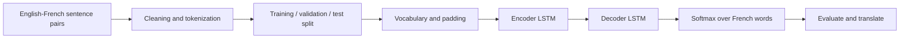

<div align="center">

# 🌍 NLP Lab 10
## Introduction to Machine Translation

**English → French · Neural Machine Translation · Encoder–Decoder LSTM**

*A solved and executed Jupyter Notebook, based on the instructor's original lab.*

**Faisal AL Zahrani** · **2230000363** · **9MA1**  
ARTI 501 — Natural Language Processing

</div>

---

## 📖 About the Lab

Machine Translation (MT) automatically converts text from one language to another. This lab explores **Neural Machine Translation (NMT)** through an English-to-French example, then applies the same idea to an **e-commerce scenario**: translating product details, customer reviews, orders, prices, and shipping information for French-speaking customers.

The notebook retains the instructor's **original introduction, figures, explanations, tokenization example, LSTM model, and sample inference code**. Solutions have been added under the two existing tasks.

### 🎯 Learning objectives

- Understand common translation challenges: *ambiguity, idioms, and low-resource languages*.
- Convert text to word IDs using **Tokenization** and align sequence lengths using **Padding**.
- Explain what **Embedding**, **Encoder LSTM**, **Decoder LSTM**, and **Softmax** do.
- Build an English → French translation workflow with paired sentences.
- Split data into **training / validation / testing** sets, evaluate, and inspect example translations.

## 🧩 Lab Tasks

| Task | Requirement | Solution in the notebook |
|:--|:--|:--|
| **Task 1** | Answer four questions about the architecture | Four clear, original English-language explanations, in the existing Task 1 answer section |
| **Task 2** | Build an English–French solution for an e-commerce company | Data loading, preprocessing, tokenization, vocabulary, padding, Encoder–Decoder LSTM, training, loss plot, test evaluation, and shopping-related inference |

### Task 1: Model layer explanations

1. **Embedding** converts a token ID into a learned dense vector.
2. **Encoder LSTM** reads the English sentence and encodes its context into hidden and cell states.
3. **Decoder LSTM** uses the encoder context to generate French representations over time.
4. **Softmax** converts output scores into a probability distribution over French vocabulary items.

### Task 2: Translation pipeline



**Note:** The model used for Task 2 is an instructional, small seq2seq architecture; it is **not** a production translation engine.

## 🗂️ Files

```text
NLP_Lab10/
├── Lab10_Introduction_to_Machine_Translation-2_Solved.ipynb
├── README.md
└── requirements.txt
```

The notebook contains **saved execution outputs**, including the instructor's original sample training and the solved Task 2 demonstration.

## ▶️ Run in Google Colab (recommended)

1. Open [Google Colab](https://colab.research.google.com/).
2. Select **File → Upload notebook** and choose the provided `.ipynb` file.
3. Run **Runtime → Run all**.
4. If packages are missing, run:

```python
%pip install -q tensorflow pandas numpy scikit-learn matplotlib kagglehub
```

5. Check the Task 2 **Dataset source**, training history, masked accuracy, and generated translations.

**Important:** Running the notebook again may produce different translations depending on the dataset, random seed, and available environment. Saved outputs are from the verified **offline demo run**, not from the full Kaggle dataset.

## 💻 Run locally

**Option A — TensorFlow**

```bash
python -m pip install tensorflow pandas numpy scikit-learn matplotlib kagglehub notebook
jupyter notebook Lab10_Introduction_to_Machine_Translation-2_Solved.ipynb
```

**Option B — Keras 3 + PyTorch (without TensorFlow)**

```bash
python -m pip install keras torch pandas numpy scikit-learn matplotlib kagglehub notebook
jupyter notebook Lab10_Introduction_to_Machine_Translation-2_Solved.ipynb
```

The notebook includes a lightweight compatibility setup to run the **unchanged instructor example** with Keras/PyTorch when TensorFlow is unavailable. If TensorFlow is installed, the example uses it directly.

## 📚 Dataset

**Preferred source:** [Kaggle — Language Translation (English–French)](https://www.kaggle.com/datasets/devicharith/language-translation-englishfrench)

Task 2 tries to download this dataset using `kagglehub`. If Kaggle is unavailable, it **explicitly** falls back to a built-in demonstration of **60 English–French pairs**. That dataset is suitable only for testing the code, not assessing real-world translation quality.

You can also use a locally downloaded bilingual CSV by setting `LAB10_DATASET_PATH` before running the Task 2 cells, for example:

```python
import os
os.environ["LAB10_DATASET_PATH"] = "/content/english_french.csv"
```

The input should contain **English** and **French** text columns, or have the English/French texts in the first two columns. The helper can also read TSV-style bilingual sentence files.

### Settings you can change

| Setting | Default | Meaning |
|:--|:--|:--|
| `LAB10_MAX_ROWS` | `5000` | Maximum examples sampled after cleanup |
| `LAB10_EPOCHS` | `6` | Maximum training epochs when using a real dataset |
| `LAB10_USE_DEMO` | `0` | Set to `1` to deliberately use offline demonstration data |
| `LAB10_DATASET_PATH` | Not set | Optional path to a local dataset |

In **demo mode**, Task 2 limits training to **2 epochs** to verify the pipeline quickly.

## 📈 What the saved output means

The attached notebook was run with the built-in **offline demo**, and produced:

- **60 bilingual pairs** after cleaning.
- **48 training / 6 validation / 6 test** examples.
- A training/validation loss plot and a sample translation table.
- A **masked next-token accuracy of approximately 24.24%** on the tiny held-out demo set.

**Interpretation:** This is a short execution test, **not a meaningful measure of translation performance**. Small datasets, unknown words (`<unk>`), and insufficient training can result in incomplete, repeated, or incorrect translations. The initial instructor model also uses only three example sentence pairs and should be viewed as a demonstration of the architecture.

## 🧪 Key evaluation concept

**Masked next-token accuracy** counts correct predictions only at true target-token positions, ignoring padding tokens. The evaluation is teacher-forced, so the metric is **not equivalent to sentence-level translation accuracy**. For a larger, real project, translation quality should also be assessed with human examples and metrics such as BLEU or chrF.

## 🛠️ Troubleshooting

| Issue | Suggestion |
|:--|:--|
| `ModuleNotFoundError` | Install the relevant packages, then restart the kernel and **Run all** |
| Kaggle download fails | Ensure Kaggle access/network, set `LAB10_DATASET_PATH`, or set `LAB10_USE_DEMO=1` |
| Execution is slow | Reduce `LAB10_MAX_ROWS` or `LAB10_EPOCHS`; consider a GPU runtime |
| Wrong or repetitive translations | This is expected with tiny demo data; use a larger aligned translation corpus |
| Output looks different from the saved output | Training involves randomness and model quality depends heavily on dataset and runtime |

---

**Original lab:** [MohammedMosuily/NLP_lab10](https://github.com/MohammedMosuily/NLP_lab10)  
**Task solution by:** Faisal AL Zahrani · 2230000363
