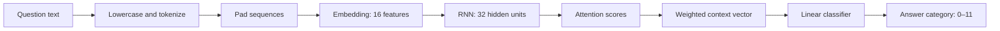

# NLP Lab 11 · Attention with RNN

**Natural Language Processing | ARTI 501**  
**Student:** Faisal AL Zahrani · **Student ID:** 2230000363 · **Section:** 9MA1

> **Lab goal:** Learn how an RNN can use an attention mechanism to emphasize different words while classifying natural-language questions.

   

## Overview

Lab 11 uses a small question-and-answer dataset to train a **question classifier**. The model reads each question, computes an attention weight for each word, combines the word representations, and predicts one of 12 answer categories. While the original teaching diagram discusses encoder–decoder attention, the actual code here is a **single-RNN attention-based classifier**, not a text-generating encoder–decoder.



## Repository files

```text
NLP_Lab11_Faisal_AL_Zahrani/
├── Lab_11_Attention_with_RNN.ipynb   # Original lesson structure + solved tasks + saved outputs
├── dataset/
│   └── Lab_11_QnA_Dataset.csv        # Original Q&A dataset from the lecturer's repository
├── assets/
│   ├── step6_original_attention.png
│   ├── task1_attention.png
│   └── task2_attention.png
├── requirements.txt
└── README.md
```

## Data

The original lecturer-provided CSV has **168 questions**, divided evenly into **12 answer groups** (14 examples per class). Its columns are:

| Column | Meaning |
|---|---|
| `question` | Natural-language question asked by the user |
| `answer_id` | Target answer category (`0` through `11`) |
| `answer` | Human-readable answer corresponding to the category |

The notebook automatically finds the dataset at `dataset/Lab_11_QnA_Dataset.csv` (recommended). It also supports the legacy Google Colab location `/content/Lab_11_QnA_Dataset_Download.csv`.

## How to run

### Option A · Jupyter Notebook / VS Code

1. Extract the ZIP and open a terminal in the extracted folder.
2. Create an environment (recommended) and install dependencies:

   ```bash
   python -m venv .venv
   # Windows PowerShell: .venv\Scripts\Activate.ps1
   # macOS/Linux: source .venv/bin/activate
   pip install -r requirements.txt
   ```
3. Open `Lab_11_Attention_with_RNN.ipynb` in Jupyter or VS Code, select your Python kernel, and use **Run All**.

### Option B · Google Colab

1. Upload `Lab_11_Attention_with_RNN.ipynb` to Colab.
2. Also upload `Lab_11_QnA_Dataset.csv` to `/content/` (or create a `dataset/` folder next to the notebook).
3. Run all cells. Pre-existing saved outputs are visible before rerunning.

**TensorFlow is optional.** If Keras is available, the notebook uses its `Tokenizer` and `pad_sequences`. Otherwise, a small built-in implementation performs equivalent word numbering and zero-padding for this exercise. PyTorch handles the model and training.

## Lab walkthrough

| Step | What happens | Why it matters |
|---|---|---|
| 1. Imports | Load PyTorch, pandas, and plotting tools | Reproducible local execution |
| 2. Dataset | Read the questions, labels, and reference answers | Define the classification task |
| 3. Preprocessing | Lowercase, tokenize, assign integer IDs, pad | Convert text into fixed-size tensors |
| 4. Model | `Embedding → RNN → Attention → Linear` | Learn word representations and relevance weights |
| 5. Training | Minimize cross-entropy with Adam for 50 epochs | Learn category predictions from labeled questions |
| 6. Visualization | Plot weights for a single original question | See where the model focuses |
| Task 1 | Visualize **three different questions** | Compare their most-attended words |
| Task 2 | Compare **two semantically similar questions** | See how different wording affects attention |

### Task 1 · Three questions


| Question | Top word | Attention weight |
|---|---|---:|
| Do you get hurt? | `get` | 0.893 |
| What's your birthday? | `birthday` | 0.503 |
| Who created you? | `created` | 0.473 |

**Interpretation:** `birthday` and `created` are useful topic indicators. For the first question, the model emphasizes the less specific word `get`; this illustrates that attention scores do not always match a human's judgment of a word's importance. **The weights explain the model's distribution of attention, not necessarily causal feature importance.**

### Task 2 · Similar meaning, different wording


| Question | Top word | Weight | Predicted answer group |
|---|---|---:|---:|
| Are you old? | `old` | 0.919 | 1 |
| What year were you born? | `born` | 0.899 | 1 |

**Interpretation:** Although these questions ask about age in different ways, the model focuses on different age-related words and predicts the same category. Attention weights adapt to the sequence and its learned representations.

## Execution results

| Check | Saved result |
|---|---|
| Executed code cells | **8 of 8**, without errors |
| Training epochs | **50** |
| Initial training loss | **2.5131** |
| Final training loss | **0.0688** |
| Accuracy measured on training examples | **98.8%** |
| Task 1 visualizations | **3 charts** |
| Task 2 visualizations | **2 charts** |

> **Evaluation note:** 98.8% is **training-set accuracy**, not held-out test accuracy. The examples used in Tasks 1 and 2 are also from the training data. This small demonstration does **not** establish performance on previously unseen questions.

## Improvements needed to run the lecturer's code correctly

The original educational content, step order, model idea, and assignment questions are preserved. A few minimal implementation corrections were necessary for reliable execution:

- Use `batch_first=True` in `nn.RNN` to handle the `[batch, sequence, embedding]` tensor layout.
- Apply `optimizer.zero_grad()` on each iteration so gradients do not accumulate across epochs.
- Exclude zero-padding positions when normalizing attention weights.
- Load the CSV from the accompanying `dataset/` folder rather than requiring a hard-coded Colab path.
- Make the unused Colab import optional and provide a local tokenizer fallback when TensorFlow is unavailable.
- Keep and display the original single-question chart, then add complete solutions and written observations for both tasks.

## Source and credit

Original teaching materials and dataset: [MohammedMosuily/NLP_lab11](https://github.com/MohammedMosuily/NLP_lab11).  
This submission adds the **student identification, implementation fixes, completed tasks, saved execution outputs, and documentation**.
